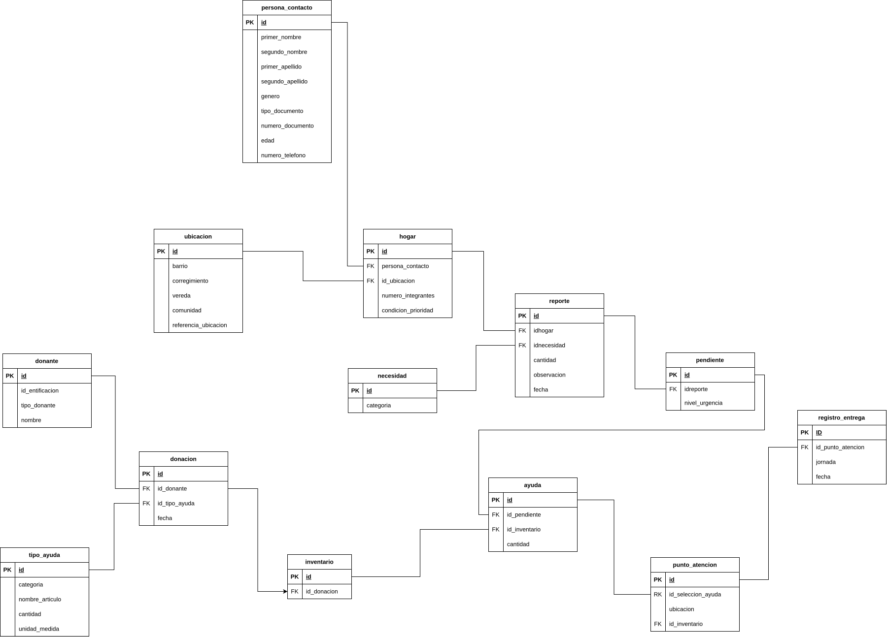

# BASE DE DATOS PARA AYUDAS HUMANITARIAS
Esta base de Datos SQL tiene como objetivo hacer Control y Seguimiento a la entrega de ayudas humanitarias ante desastres naturales como un terremoto.

La base de datos permite registrar hogares afectados, identificar sus necesidades, recibir donaciones, controlar la disponibilidad de las ayudas y dejar constancia de las entregas de estas.

## Aspectos Técnicos.
1. **Manejo de Prioridad en Entregas.**
  Se decidió como equipo manejar las prioridades de la siguiente manera:

   1. ***Condición Especial***: Los hogares que presenten alguna condición especial, son los de la mas alta prioridad.
   
      *Clasificación*: Gestantes, Niños, Ancianos y Discapacitados.

      *Orden de Prioridad*: 1) Gestantes - 2) Niños - 3) Personas Discapacitadas - 4) Ancianos

   2. ***Tipo de Necesidad***: Los hogares manifiestan su necesidad para así poder brindarles la ayuda humanitaria necesaria.

      *Clasificación*: Alimentaria, Refugio Temporal, Agua, Aseo y Medicamentos.

      *Orden de Prioridad*: 1) Refugio - 2) Agua - 3) Alimentación - 4) Medicamento - 5) Aseo

   3. ***Sistema de Puntuaciones***: Las categorías anteriores contarán con puntos, donde la mayor prioridad obtendrá el número mas alto y la menor el más bajo.

   4. ***Desempates***: En el caso de que dos o mas hogares cuenten con la misma puntuación, se usara el modelo de primeros en entrar primeros en salir para así terminar de organizar la lista de entregas pendientes.

1. **Modelo Entidad Relación.**

  

3. **Resolución de Reglas.**

      Código: Condición verificable.
- [x] R-01: Cada hogar tiene un identificador estable, aunque cambie su lugar temporal de permanencia.
- [x] R-02: Un hogar puede reportar distintos tipos de necesidad.
- [x] R-03: Un tipo de necesidad puede aparecer en los reportes de muchos hogares.
- [x] R-04: El reporte debe conservar datos propios de la relación, como urgencia, cantidad estimada, estado y observación.
- [x] R-05: Un donante puede realizar varias donaciones.
- [ ] R-06: Una donación puede incluir distintos tipos de ayuda, cada uno con cantidad y unidad de medida.
- [x] R-07: El mismo tipo de ayuda puede aparecer en distintas donaciones.
- [ ] R-08: Un hogar puede recibir varias entregas en momentos diferentes.
- [x] R-09: Cada entrega ocurre en un solo punto de atención, pero un punto registra muchas entregas.
- [ ] R-10: Una entrega puede incluir varios tipos de ayuda y un tipo de ayuda puede aparecer en muchas entregas.
- [ ] R-11: La cantidad entregada pertenece al detalle de la entrega, no al hogar ni al tipo de ayuda.
- [ ] R-12: Debe diferenciarse la fecha de entrega de la fecha de registro en el sistema.
- [x] R-13: Cada tipo de ayuda debe tener una unidad de medida estándar, usada tanto en las entradas como en las entregas.
- [ ] R-14: Una entrega confirmada no puede dejar el inventario con saldo negativo.
- [ ] R-15: Una persona usuaria puede tener varias funciones y una función puede corresponder a varias personas.
- [ ] R-16: La asignación de una función debe poder activarse o finalizar sin eliminar a la persona ni la función.
- [x] R-17: Toda cantidad debe ser mayor que cero y expresarse en la unidad definida para ese tipo de ayuda.